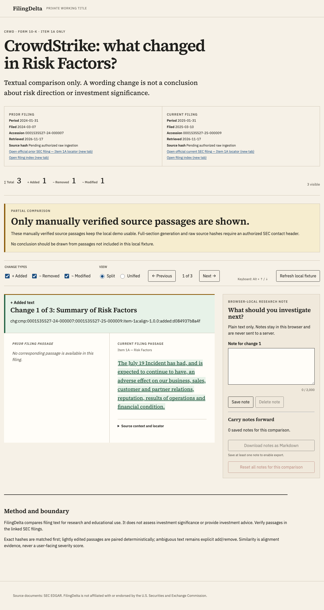

# DisclosureTrace

DisclosureTrace is a source-linked workspace for reviewing how Item 1A risk-factor wording changes between selected annual 10-K filings.

[Open the live application](https://disclosuretrace.vercel.app) · [View Nora Rasuli's portfolio](https://nora-rasuli.github.io)



## Product overview

Reading two long filings side by side makes it easy to lose the exact wording, source context, and follow-up questions that matter. DisclosureTrace turns that work into a focused review queue:

- compare added, removed, and modified passages in split or unified view;
- filter and navigate changes with URL-restorable state and keyboard controls;
- inspect prior and current context with links to the official SEC filings;
- save browser-local research notes and export them as Markdown;
- recover from partial data and request failures without presenting an invented complete result.

The current release contains five fixed, curated Item 1A filing pairs. Text classifications describe wording operations only; they do not assess materiality, risk direction, or investment value.

## Demo path

1. Choose a company from the five-pair catalog.
2. Filter the review queue to modified wording.
3. Move through the changes and inspect the prior/current filing context.
4. Save a note, reload the page, and export the comparison notes as Markdown.

No account is required. Notes stay in the current browser and do not sync to a server.

## Engineering highlights

- **Typed fixture boundary:** Zod contracts validate the versioned catalog, filings, comparison records, exclusions, and provenance.
- **Deterministic textual comparison:** exact blocks are matched first; lightly edited blocks use token similarity and ambiguity rules; unmatched text remains explicit addition or removal.
- **URL-owned review state:** view mode, filters, and active change survive reloads and support shareable review positions.
- **Accessible document interaction:** prior text precedes current text in the DOM, labels and symbols supplement color, keyboard navigation moves focus, and layouts reflow to 320 px.
- **Failure-aware UX:** loading, partial, empty-filter, unavailable, retry, not-found, and local-storage failure behavior are explicit.
- **Privacy by construction:** note creation, storage, deletion, reset, and Markdown export happen client-side.

## Architecture

```text
SEC EDGAR
   │  explicit maintenance command
   ▼
retrieval → Item 1A extraction → normalized blocks → textual alignment
   │
   ▼
versioned comparison fixtures + provenance
   │
   ▼
Next.js API → React review workspace
                    │
                    └── browser-local notes + Markdown export
```

The deployed application makes no live SEC request. Source retrieval and fixture generation are separate maintenance operations, keeping the user path reliable and the data boundary inspectable.

## Quality evidence

For the current release:

- 33 unit and component tests pass.
- 10 production-mode Playwright tests pass across desktop and mobile profiles.
- Formatting, ESLint, strict TypeScript, fixture-integrity checks, and the production build pass in GitHub Actions.
- The production dependency audit reports no known vulnerabilities.
- Local Lighthouse audits recorded median performance and accessibility scores of 100 on the catalog and comparison routes. One comparison run scored 86 performance, so these results should be read as a test profile rather than a universal guarantee.

Raw Lighthouse runs, screenshots, security-header captures, and browser-test reports are stored under `evidence/`.

## Technology

- Next.js 16, React 19, and TypeScript
- Zod contracts and Cheerio-based document extraction
- Vitest, Testing Library, jest-axe, and Playwright
- GitHub Actions and Vercel

## Run locally

### Requirements

- Node.js 22–24
- pnpm 10.21.0

```bash
pnpm install --frozen-lockfile
pnpm quality
pnpm test:e2e
pnpm dev
```

The application and test suites do not require credentials. SEC ingestion is intentionally separate and requires a descriptive `SEC_USER_AGENT` that follows SEC access guidance.

## Data and limitations

- The catalog is intentionally limited to five fixed annual filing pairs and Item 1A.
- The committed comparison fixtures contain curated partial passage sets rather than universal filing coverage.
- The parser is tested against bounded structural fixtures and should not be treated as support for every 10-K format.
- Browser-local notes have no account, server backup, collaboration, or cross-device sync.
- DisclosureTrace is not affiliated with or endorsed by the U.S. Securities and Exchange Commission.

Source documents are linked to SEC EDGAR. The application source is licensed under the [MIT License](LICENSE).
