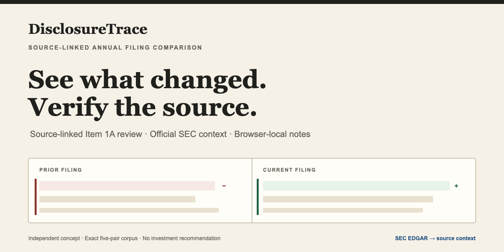

# DisclosureTrace

> **PRIVATE PUBLICATION DRAFT — BLOCKED.** The independent audit records `Not
ready`, and `originality-gate.md` records `Pivot`. Do not copy this file to the
> repository root or publish it without a material workflow pivot, new
> originality approval, technical remediation, and a publication-permitting
> re-audit.

DisclosureTrace helps research-oriented readers review how Item 1A wording
changed between selected annual 10-K filings while keeping each finding tied to
official SEC context.

**Live demo:** withheld pending material pivot, remediation, and public-session verification ·
**Case study:** withheld pending a publication-permitting re-audit

**Project type:** Private technical concept with substantial competitor overlap
**Status:** Publication blocked · **Built:** November 2026 · **Role:** Product design and full-stack product engineering



## Why it exists

Comparing annual Risk Factors disclosures manually means finding the substantive
Item 1A section in two long filings, separating real wording changes from
formatting or reordered text, reopening the source for context, and keeping
follow-up notes elsewhere.

DisclosureTrace turns that task into a bounded review flow: choose one of five
fixed filing pairs, inspect added, removed, and modified wording, open the
official filings, and save a plain-text research note in the current browser.
The project does not interpret risk direction, materiality, or investment value.

## What you can do

- Review added, removed, and modified Item 1A passages in split or unified view.
- Filter and navigate changes with URL-restorable state and keyboard focus.
- Inspect prior/current source context and open the official SEC filing and index.
- Save, update, delete, reset, and export browser-local research notes.
- Recover from explicit partial and request-failure states without a fabricated complete result.

## Demo path

1. Open the final public root route and choose CrowdStrike.
2. Filter to Modified and move through the review queue with the next control or keyboard shortcut.
3. Expand source context and verify the official prior/current filing links.
4. Save a research note, reload it, and download the current comparison's notes as Markdown.

No account is required. The public runtime uses committed versioned fixtures and
makes no live SEC request. The shipped data status and any partial-corpus
limitation must match the final audit.

## User and scenario

- **User:** A self-directed investor or research-oriented reader updating a company note after a new annual filing.
- **Trigger:** A new 10-K is available and the reader needs to review wording changes against the prior annual filing.
- **Job to be done:** Find the changed passages, inspect exact old/new context, verify both filings, and record questions without relying on an untraceable summary.
- **Disclosure:** The persona and research scenario are simulated; filing text and metadata come from SEC EDGAR.

## Engineering highlights

- **Fixture-first data boundary:** The runtime uses versioned curated partial JSON, while SEC retrieval is confined to an explicit server-side CLI. Full authorized ingestion, raw-source hashes, and live source verification are still required.
- **Deterministic alignment:** Exact block hashes are matched first; lightly edited passages use documented token alignment; ambiguous text remains explicit add/remove instead of receiving a semantic guess.
- **Stateful document review:** Route, view, filters, and active change live in the URL; async fixture state, transient UI state, and browser-local notes have separate ownership boundaries.
- **Accessible comparison semantics:** Prior text precedes current text in the DOM, change types use visible labels and symbols beyond color, and navigation moves focus to the active heading with a polite position announcement.
- **Privacy by construction:** Notes are validated plain text, remain in local storage, and export client-side without filing passage text.

## Architecture

```text
SEC EDGAR
   │  explicit maintenance command only
   ▼
retrieval → Item 1A extraction → normalized blocks → exact/greedy textual alignment
   │
   ▼
versioned provenance + comparison fixtures
   │
   ▼
Next.js read-only API → React review workspace
                              │
                              └── browser-local notes + Markdown export
```

### Key decisions

| Decision                              | Why                                                                                   | Tradeoff                                            |
| ------------------------------------- | ------------------------------------------------------------------------------------- | --------------------------------------------------- |
| Five exact filing pairs, Item 1A only | Keeps the data boundary inspectable and the demo reliable.                            | It is not arbitrary-ticker or full-filing coverage. |
| No runtime SEC request                | Avoids third-party latency, rate-limit, and contact-header exposure in the user path. | Source refreshes are explicit maintenance work.     |
| Deterministic text comparison, no AI  | Keeps every classification reproducible and avoids unsupported interpretation.        | The product does not summarize significance.        |
| Browser-local notes                   | Delivers a useful no-account workflow with no note backend.                           | Notes do not sync across devices or browsers.       |

## Quality evidence

The following figures are local audit evidence and remain withheld from public
status claims because the working tree is uncommitted and the release decision
is `Not ready`:

- 33 unit/component tests and 10 production-mode browser tests passed locally.
- Three fresh local Lighthouse runs per audited route have a median of 100 for performance and accessibility; one comparison run scored 86 performance with 2.94-second LCP and 0.193 CLS.
- Fresh comparison fixture gzip sizes are 1.5–2.2 KB; the final repaired route-script transfer was not independently remeasured.
- Automated axe checks with no recorded serious or critical violation.

The final public README must replace this paragraph with the audit-approved
measurement date, environment, profile, limitations, and raw evidence links.

## Run locally

### Prerequisites

- Node.js 22–24
- pnpm 10.21.0

```bash
pnpm install --frozen-lockfile
pnpm quality
pnpm test:e2e
pnpm dev
```

The normal app and tests do not need an SEC contact value. Source ingestion and
live source verification are separate maintenance commands with an explicit
contact-bearing `SEC_USER_AGENT`; do not run them without the required approval.

## Data, privacy, and limitations

- The concept uses a fixed five-pair 10-K corpus and compares Item 1A only.
- The current committed fixtures are documented as manually verified partial passage sets unless the final audit records a later full-ingestion state.
- Added, removed, and modified describe text operations—not risk direction, severity, materiality, or investment significance.
- Notes remain in the current browser and can be deleted individually or reset together; the application has no server copy.
- The product has no authentication, analytics, user database, AI, prediction, ranking, or recommendation feature.
- The parser is tested against bounded structural fixtures and must not be described as universal 10-K support.

## Roadmap

Only after the audited MVP is stable:

- Complete authorized full-corpus ingestion and source hashes if the release remains partial.
- Validate the workflow with real research users before making any usability or time-saved claim.
- Expand parser coverage only with new frozen fixtures, provenance, and regression evidence.

## License and acknowledgments

Source documents come from SEC EDGAR. DisclosureTrace is not affiliated with or
endorsed by the U.S. Securities and Exchange Commission. The interface uses
Source Serif 4 and IBM Plex Sans under the SIL Open Font License. Final public
license text and dependency attribution must match the audit-approved release.
